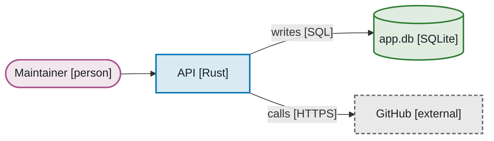
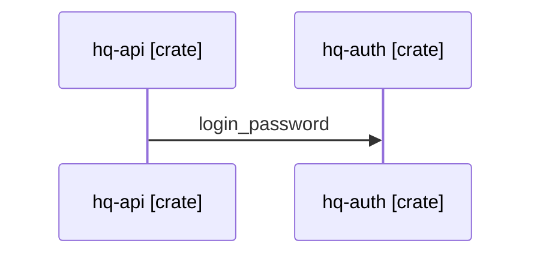

# Architecture docs and diagrams

How a repo shows what it is made of: a short `ARCHITECTURE.md`, a few hand-written diagrams of intent, and generated
diagrams of everything a file already defines (services, compose, crates, schema), checked in the gate like a
committed OpenAPI file. HQ is the example: [docs/architecture/](https://github.com/evocaslab/hq/blob/main/docs/architecture/README.md),
`scripts/docs/diagrams/`.

## Rules

| Rule | Why |
| --- | --- |
| `ARCHITECTURE.md` at the root, at most two screens: what the system does, the context and container diagrams, a codemap, the invariants | the first page a new agent or person reads; matklad's form |
| Two static views per repo: **context** (people and systems around it) and **containers** (runnable units: API, worker, web, database, proxy, timers) | C4 says these two are enough for most teams; deeper levels rot |
| No class or component diagrams of the code; the codemap names the modules in prose instead | they change with every refactor, agents refactor weekly; a generated class diagram of every class is noise |
| A **domain view** only when the domain has nouns the schema does not show (sheet rows, in-memory aggregates, external records): at most about 15 entities, their relations and 1–3 defining attributes each | the nouns a person or agent must know, not the classes that hold them |
| **Generate** what a file defines: compose, systemd units, tailnet routes, workspace crates or packages, database schema | a generated view cannot drift; a new service or table shows up by itself |
| A generated page has a "Generated by … do not edit" header and an **is-current check** in the gate | like `openapi.json`: a stale diagram fails the commit |
| **Hand-write** what expresses intent: context, containers, 2–3 cross-container flows, real state machines | no file holds that; a person decides what matters |
| A hand-written page says "Reviewed against the code on YYYY-MM-DD"; a change that adds or removes a container, store, external system or state updates it in the same commit | the one drift rule that works without tooling |
| Mermaid in fenced ` ```mermaid ` blocks; containers drawn as `flowchart` with `subgraph` boundaries | GitHub renders it with no build step; plain text diffs and reviews; agents write it reliably |
| Every box: name, `[technology]`, one line of responsibility; every arrow: one direction, what flows and how (`reads, writes [SQL 5432]`), never a bare "uses" | C4 notation: a diagram must read without a narrator |
| At most about 15 boxes and 25 arrows; split by boundary when bigger | past that nobody reads it |
| Colour only **repeats** what shape and label already say: the [palette](#colour)'s `classDef`s, one per role, no `%%{init}%%` theme, no `style` or `linkStyle` | GitHub switches Mermaid's theme with the reader's mode; colour fails in print, in grey scale and for about one man in twelve |
| Every Mermaid block opens with `accTitle` and `accDescr` | screen readers get a name and a sentence instead of an unlabelled SVG |
| A state diagram for each real state machine, **pinned by a test** that compares its states with the code's; states kept as plain strings get an enum (and a transition table) first | a state diagram that disagrees with the enum is worse than none, and strings give the test nothing to compare |
| Sequence diagrams pin their **participants**: each tagged `[crate]`, `[unit]` or `[service]` must name a real one (a check in the gate); the messages stay free text | a renamed or removed container then fails the gate; message wording is not worth pinning |
| Invariants in `ARCHITECTURE.md` are enforced by tests where a tool can (import-linter contracts, a crate-graph test) | a written boundary nobody checks is a wish |
| Decisions go to ADRs ([docs-backlog-changelog.md](docs-backlog-changelog.md)); designs to `docs/design/` | the diagram shows what is, the ADR why |

## Layout

```text
ARCHITECTURE.md                 # or docs/architecture/README.md in a docs-heavy repo (HQ)
docs/architecture/
  generated/compose.md          # one page per generated view, header "Generated by …"
  generated/services.md
  generated/schema.md
  generated/crates.md
  queue-jobs.md                 # a state machine, pinned by a test
  domain.md                     # the domain view, when there is one
  flows/<name>.md               # a sequence diagram per cross-container flow, participants pinned
scripts/docs/diagrams/          # the generator and its tests
```

## Which views

| View | Mermaid | Hand or generated | Worth it when |
| --- | --- | --- | --- |
| Context | `flowchart LR` | hand | always |
| Containers | `flowchart TB` with `subgraph` per host or network | hand; the compose view below covers the services | always |
| Compose services | `flowchart` | generated from `docker compose config --format json` | the repo ships a compose project |
| systemd units | `flowchart LR`, a `subgraph` per machine and slice | generated from the unit manifest ([system-tuning.md](https://github.com/evocaslab/hq/blob/main/practices/system-tuning.md#services-from-a-manifest)) | units are installed from a manifest |
| Workspace graph | `flowchart TD` | generated from `Cargo.toml` / `cargo metadata`, or the uv workspace's `pyproject.toml` files | more than about four crates or packages |
| Database schema | `erDiagram` | generated from the migrated schema | always when there is a database; keys and relations only past ~10 tables |
| Domain | `erDiagram` (or `classDiagram` when the nouns have behaviour that matters) | hand, entity names pinned by a test | the nouns are not all tables: a spreadsheet, a message format, an external API's records |
| Flow | `sequenceDiagram` | hand, participants pinned | a request crosses three or more containers or has an async step (queue, webhook, wake-up), or a security flow (sign-in, step-up) |
| Pipeline | `flowchart LR` | generated from the job or stage table | the stages are real objects (worker jobs, import → review → publish), never one function's control flow |
| State machine | `stateDiagram-v2` | hand, pinned by a test | the code has states and rules for moving between them |
| Deployment | `flowchart` | hand | several machines or environments differ from the container view |

Not worth it for small repos: a system landscape, all of arc42's sections, UML class diagrams, user journeys (product
docs, not architecture).

Mermaid dialects to avoid in committed docs: `C4Context`/`C4Container` (its docs still call it "an experimental
diagram for now", and the layout is rigid) and `architecture-beta` (beta, icon packs GitHub does not load).

## Colour

Colour helps a sighted reader find the stores or the outside systems at a glance; it never carries meaning alone. Each
role has a shape (or, for `external`, a dashed outline and the `[external]` label), so the diagram reads the same in
grey scale, in print and for colour-blind readers.

| Role | Shape cue | Outline | Fill |
| --- | --- | --- | --- |
| `person` | stadium `([…])` | `#A8558A` | `#F2E6ED` |
| `service` | box `[…]` | `#0072B2` | `#D9EAF3` |
| `store` | cylinder `[(…)]` | `#2E7D32` | `#E0ECE0` |
| `trigger` | stadium, named `.timer` / `.path` | `#A35F00` | `#F1E7D9` |
| `external` | any, dashed outline, `[external]` | `#6E6E6E` | `#E9E9E9` |



- **Hues**: Okabe–Ito, darkened until each outline has at least 3:1 contrast on both GitHub backgrounds (`#ffffff`,
  `#0d1117`; WCAG 1.4.11 for graphics). Every pair of outlines stays at least ΔE 10 (CIE76) apart under simulated
  protanopia, deuteranopia and tritanopia (Machado 2009).
- **Fills** are opaque light tints and the text colour is fixed (`#1B1F24`, at least 7:1 on every fill, WCAG AAA).
  A transparent fill mixes with the theme's subgraph colour (blue on yellow turns green), and the theme's own text
  colour turns light in dark mode.
- **Whole diagram or nothing**: once a block has a `classDef`, every box takes a class; an unclassed box would show
  the theme's default fill and look like one more role. A view with one kind of box (the crate graph) stays plain.
- **Legend**: a page with coloured diagrams says once that the colours repeat the shapes, linking here.
- Edges, subgraphs and the `erDiagram`, `sequenceDiagram` and `stateDiagram` types keep the theme's colours.

The gate pins it: `colour_problems` in HQ's `scripts/docs/diagrams/diagrams.py` (run by `check` over generated and
hand-written pages) rejects themes, `style` lines, classDefs that are not the palette's, a role drawn without its
shape, and unclassed boxes in a coloured block. `test_diagrams.py` recomputes the contrast and simulated distances
from `ROLES`, so a palette change that breaks them fails.

## Generated views

One small generator per repo (a uv script, Typer subcommands `write` and `check`), with pure functions per view so
tests can feed it a temp tree. HQ's: `scripts/docs/diagrams/diagrams.py`, run as `just docs-diagrams`
(`just docs-diagrams check` only reports).

- **Hermetic and fast sources go in the gate.** YAML manifests, `Cargo.toml`, `docker compose config` and SQLite
  migrations applied to an in-memory database take milliseconds: a prek hook runs `check` when a source or the
  generator changes (HQ: `diagrams-current`).
- **Sources that need a running service go to a recipe**, not a commit hook: a PostgreSQL ERD needs a database at
  `head`. Generate it in the test-container job that already migrates a throwaway database
  ([testing.md](testing.md)) and compare there, with [mermerd](https://github.com/KarnerTh/mermerd) (MIT, Go,
  PostgreSQL, MySQL, SQLite; Mermaid `erDiagram` on stdout) or a query over `information_schema`.
- **Compose**: `docker compose config --format json` already resolves `include`, profiles, `extends` and env
  ([docker-compose-layout.md](https://github.com/evocaslab/hq/blob/main/practices/docker-compose-layout.md)). Draw services as boxes (image or build context, memory
  limit), `depends_on` as arrows labelled with their condition (`service_healthy`), networks as subgraphs, published
  ports on an edge from a `host` node, named volumes as cylinders `[(name)]`. Profiles that are off by default are
  listed in the intro, not drawn.
- **Schema from SQLite**: apply every migration to `:memory:`, then `pragma_table_info` and
  `pragma_foreign_key_list` per table. A foreign key that is the whole primary key is one-to-one (`||--o|`),
  otherwise one-to-many (`||--o{`). Mark PK, FK and nullable columns.
- **ORM models** (SQLAlchemy): the migrated database is the truth, so the schema view comes from it; parity between
  models and migrations is `alembic check`, not a second picture. When a repo wants the models drawn anyway,
  [paracelsus](https://github.com/tedivm/paracelsus) (MIT) writes a Mermaid `erDiagram` from `Base.metadata` and has
  `inject --check` for a hook, or the repo's own generator reads `Base.metadata` in about 40 lines.
- **Live PostgreSQL**: besides mermerd, [tbls](https://github.com/k1LoW/tbls) (MIT) writes Markdown with a Mermaid ER
  diagram and has `tbls diff` for CI; both belong in the test-container job.
- **Not these tools**: erdantic, eralchemy2 and django-extensions `graph_models` need Graphviz and write no Mermaid;
  pyreverse (GPL-2.0, `.mmd` output) draws every class, so only scoped with `--class`; rustdoc JSON needs nightly; the
  Rust and TypeScript class-diagram generators are abandoned or GPL. No maintained tool turns traces into sequence
  diagrams: worth a small script over OTLP JSON only once a repo exports traces.
- **Labels**: always quoted, `"` written as `#quot;`, backticks stripped (Mermaid reads backtick strings as markdown);
  node ids reduced to `[0-9A-Za-z_]`.

## State machines pinned to code

A state diagram earns its place when the code keeps named states and rules for moving between them. The test parses
the diagram's arrows and compares the state names with the code's list (an enum, a `Literal`, a tuple):

```python
block = doc.read_text().split("```mermaid\n", 1)[1].split("```", 1)[0]
edges = re.findall(r"^\s*(\[\*\]|\w+) --> (\[\*\]|\w+)", block, flags=re.MULTILINE)
assert {s for e in edges for s in e} - {"[*]"} == set(q.DIRS)
```

HQ: [docs/architecture/queue-jobs.md](https://github.com/evocaslab/hq/blob/main/docs/architecture/queue-jobs.md), `test_states_match_the_diagram` in
`scripts/machine/queue/test_queue.py`. When the code also has a transition table, compare the arrows with it too; when
it has none, the diagram is a reason to add one.

## Pins on hand-written pages

The generator's `check` also reads every hand-written page under `docs/architecture/` (not `generated/`): each must say
"Reviewed against the code on YYYY-MM-DD", and every sequence participant tagged `[crate]` or `[unit]` must name a
workspace crate or a unit in the manifest; other tags (`[browser]`, `[external]`) are free. A compose repo adds
`[service]` for `docker compose config` services. A domain view pins its entity names the same way: the test parses
the diagram's entities and compares them with the code's list (`Base.metadata.tables`, a registry, an `__all__`).



HQ: [flows/sign-in.md](https://github.com/evocaslab/hq/blob/main/docs/architecture/flows/sign-in.md), `broken_pins` in `scripts/docs/diagrams/diagrams.py`.

## Invariants as tests

Each boundary named in `ARCHITECTURE.md` gets a check that cites it:

| Stack | Check |
| --- | --- |
| Python | [import-linter](https://github.com/seddonym/import-linter) (BSD-2) contracts: `layers`, `forbidden` (domain never imports web or CLI), `independence` |
| Rust | a test over `cargo metadata` that core crates have no edge to adapter crates ([rust-service.md](https://github.com/evocaslab/hq/blob/main/practices/rust-service.md)); [cargo-modules](https://github.com/regexident/cargo-modules) (MPL-2.0) `dependencies --acyclic` inside a crate |
| Compose | a test that only the proxy publishes ports, every service has a memory limit |

## Tests that pin it

- The generator's unit tests (HQ: `scripts/docs/diagrams/test_diagrams.py`, hook `diagrams-tests`): escaping, each
  view from a temp repo, cardinality and nullable marks, `check` finds missing and hand-edited files.
- The is-current hook (`diagrams-current`): generated pages current, hand-written pages dated and their pinned
  participants real.
- The state-diagram test beside the code it pins.
- Once per new diagram: render it in Mermaid (GitHub's preview, or a local page importing the same major version) in
  light and dark. `mermaid.parse` catches syntax errors; only a look catches an unreadable layout (HQ's container view
  went from `LR` to `TB` for that reason). With colour, look once more through a deuteranopia filter (an SVG
  `feColorMatrix` on the page, or the browser's DevTools "Emulate vision deficiencies").
- The palette tests: outline contrast on both backgrounds, text on fills, simulated colour-blind distance, and
  `colour_problems` on the generated views.

## Platform variants

- **No compose, no database** (a CLI, a library): `ARCHITECTURE.md` with the codemap and a context diagram; a
  workspace graph only past four packages.
- **Desktop GUI** ([desktop-gui.md](https://github.com/evocaslab/hq/blob/main/practices/desktop-gui.md)): containers are the app process, background workers, the local
  store, and any service it calls; a state diagram for the main window's modes when they have rules.
- **Bigger than Mermaid fits**: [D2](https://d2lang.com/) (MPL-2.0, better layouts) with the SVG committed and a
  render check; [Structurizr DSL](https://docs.structurizr.com/dsl) once a repo needs more than a handful of views
  of one model. Neither renders on GitHub by itself.

## Creating or refreshing a repo's docs

The `/architecture-docs` skill in HQ (`.claude/skills/architecture-docs/`) does this for one repo by that repo's own
rules: inventory, a plan of the views, the generator and its hooks, the hand-written pages with their pins, a render
check, landing.

## Sources

- Simon Brown, [The C4 model](https://c4model.com/diagrams): levels, [notation](https://c4model.com/diagrams/notation),
  [FAQ](https://c4model.com/diagrams/faq).
- Aleksey Kladov (matklad), [ARCHITECTURE.md](https://matklad.github.io/2021/02/06/ARCHITECTURE.md.html).
- Michael Nygard, [Documenting architecture decisions](https://cognitect.com/blog/2011/11/15/documenting-architecture-decisions).
- [arc42](https://arc42.org/overview), for the sections a bigger system may need.
- Mermaid: [C4 (experimental)](https://mermaid.js.org/syntax/c4.html),
  [architecture (beta)](https://mermaid.js.org/syntax/architecture.html),
  [state diagrams](https://mermaid.js.org/syntax/stateDiagram.html), [theming](https://mermaid.js.org/config/theming.html).
- GitHub, [Creating diagrams](https://docs.github.com/en/get-started/writing-on-github/working-with-advanced-formatting/creating-diagrams);
  dark-mode readability: [community discussion 35733](https://github.com/orgs/community/discussions/35733).
- Tools: [paracelsus](https://github.com/tedivm/paracelsus), [tbls](https://github.com/k1LoW/tbls),
  [mermerd](https://github.com/KarnerTh/mermerd),
  [pyreverse](https://pylint.readthedocs.io/en/latest/additional_tools/pyreverse/index.html).
- Colour: Okabe and Ito, [Color Universal Design](https://jfly.uni-koeln.de/color/); WCAG 2.2
  [1.4.1 Use of Color](https://www.w3.org/WAI/WCAG22/Understanding/use-of-color.html),
  [1.4.11 Non-text Contrast](https://www.w3.org/WAI/WCAG22/Understanding/non-text-contrast.html),
  [1.4.6 Contrast (Enhanced)](https://www.w3.org/WAI/WCAG22/Understanding/contrast-enhanced.html); Machado, Oliveira
  and Fernandes, [A physiologically-based model for simulation of color vision deficiency](https://www.inf.ufrgs.br/~oliveira/pubs_files/CVD_Simulation/CVD_Simulation.html)
  (2009); Mermaid [classDef](https://mermaid.js.org/syntax/flowchart.html#classes) and
  [accessibility options](https://mermaid.js.org/config/accessibility.html).
- Write the Docs, [Docs as code](https://www.writethedocs.org/guide/docs-as-code/).
